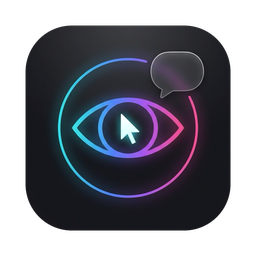

<p align="center"></p>

<h1 align="center">VisionCLI</h1>

<p align="center">
Let Claude see your screen. Ask about the file, error, UI, database table or web page you're looking at,<br>
by typing in <b>Claude Code or Gemini</b> (Antigravity / Gemini CLI) or <b>by voice</b>, with the answer floating above your mouse pointer.
</p>

<p align="center">
<a href="https://github.com/thethirdsourcers/visioncli/releases/latest"><b>⬇︎ Download VisionCLI for macOS</b></a>
</p>

---

- **"What is this file for?"** Claude looks at the window under your mouse, finds the real file in your project and answers with `file:line` references.
- **Hold ⌥ Space and ask out loud.** A loader rides on your cursor, and the answer appears in a bubble above it, read aloud.
- **Works with your Claude Code session.** It types into the `claude` already running for that project, or opens one, so you can type and talk in the same conversation.
- **Points at things.** Claude draws glowing boxes on your screen around what it's talking about.
- **Fast browser control.** "Open the Stripe tab", "click sign in", "pause the video" run in under a second (via TypeSafe Jev), with a visible AI cursor.
- **Knows your data.** Read-only database questions ("how are payments and orders related?") using your project's `.env`.

## Install

### Requirements

- macOS 13 or later (Apple Silicon or Intel)
- At least one AI CLI, installed and signed in: [Claude Code](https://claude.com/claude-code) (`claude`), [Antigravity CLI](https://antigravity.google) (`agy`, Gemini on a Google account), or [Gemini CLI](https://github.com/google-gemini/gemini-cli) (`gemini`)
- [Node.js](https://nodejs.org) 18 or later

### 1. Download the app

1. Download **`VisionCLI-<version>-macos.dmg`** from the [latest release](https://github.com/thethirdsourcers/visioncli/releases/latest).
2. Open it and drag **VisionCLI** into **Applications**.
3. The app isn't notarized by Apple yet, so the first time:
   - **Right-click VisionCLI → Open → Open**, or
   - run `xattr -dr com.apple.quarantine /Applications/VisionCLI.app` in Terminal.

### Updates

VisionCLI checks GitHub for new releases at launch and every 6 hours. When one is out, 👁 shows **Install Update**: it downloads the release, checks it's signed with the same certificate, replaces the app and restarts, keeping your permissions and settings. Use 👁 → Settings → *Check for Updates…* to check now, or turn automatic checks off there.

### 2. First launch

The 👁 icon appears in the menu bar and a welcome screen offers to set up the CLIs it finds. That registers VisionCLI's tools for every project: `claude mcp add visioncli --scope user …` for Claude Code, the global MCP config for Antigravity CLI, and `gemini mcp add -s user --trust visioncli …` for Gemini CLI. You can also do it later from 👁 → Settings → *Set Up …*.

macOS will ask for three permissions. VisionCLI needs all of them:

| Permission | Why |
|---|---|
| **Microphone** and **Speech Recognition** | to hear your question while you hold ⌥ Space |
| **Screen & System Audio Recording** for **VisionCLI** | to see the window you're asking about in voice mode. After allowing it, quit and reopen VisionCLI. |
| **Screen & System Audio Recording** for **your terminal app** (iTerm, Terminal, Warp…) | when you *type* to Claude Code, the screenshot is taken by the terminal running `claude`. Without it, Claude only sees the wallpaper. Restart the terminal after allowing it. |
| **Automation** (iTerm, Chrome/Brave) | asked the first time it types into your terminal or controls the browser |

If something doesn't work, check System Settings → Privacy & Security, and 👁 → Settings → *Open Log*.

### 3. Optional extras

| Add | Get | How |
|---|---|---|
| **Whisper** | More accurate transcription of names and jargon (~0.7s, local) | 👁 → Voice & Audio → Speech Recognition → **Download Whisper** (installs `whisper-cpp` via Homebrew, then downloads the ~490 MB model) |
| **Kokoro** | Natural voices for spoken answers (local) | 👁 → Voice & Audio → Voice → **Download Natural Voices** (installs [`uv`](https://docs.astral.sh/uv/) if needed, then downloads ~350 MB) |
| **TypeSafe Jev** | Instant browser commands | add your key via 👁 → Settings → *API Keys*, or set `TYPESAFE_API_KEY` |
| **Browser control** | Click, scroll and read pages | in Chrome or Brave: **View → Developer → Allow JavaScript from Apple Events** |

Models are saved in `~/Library/Application Support/visioncli/models/`. Whisper and Kokoro models you already have from other tools (e.g. in `~/.cache/whisper`) are picked up automatically. Without them, VisionCLI uses Apple's on-device speech recognition and the system voice.

## Gemini (Antigravity CLI or Gemini CLI)

VisionCLI works with Gemini as well as Claude, using your own sign-in, the same way it uses your `claude` login:

| | Use when |
|---|---|
| **Antigravity CLI** (`agy`) | You sign in with a personal Google account. Google now serves personal accounts through Antigravity. |
| **Gemini CLI** (`gemini`) | Your Gemini CLI sign-in still works (paid Code Assist / work account), or you add an API key. |

- **Set up:** 👁 → Settings → *Set Up Antigravity CLI* / *Set Up Gemini CLI* (or `visioncli install`, which registers every CLI it finds).
  - Antigravity: adds visioncli to `~/.gemini/config/mcp_config.json` and allows its read-only/navigation tools in `~/.gemini/antigravity-cli/settings.json`.
  - Gemini CLI: `gemini mcp add -s user --trust visioncli …`.
- **Typing:** in `agy` or `gemini`, the visioncli tools (look, browser, database, device screenshots…) are available in every workspace.
- **Voice:** choose 👁 → **Assistant → Gemini (Antigravity CLI)** or **Gemini CLI**.
  - *Terminal* mode types your question into the `agy`/`gemini` running for the project (or opens one) and shows the answer in the terminal and the bubble.
  - *Bubble Only* mode runs it headless (`agy -p … --output-format stream-json`, or `gemini -p … -o stream-json`) and continues the same conversation each time.
- **Pointing at a terminal** that runs `claude`, `agy` or `gemini` uses that CLI, whatever the Assistant setting.

**Notes:**
- In Bubble Only mode the CLI can't ask for approval, so it only reads (code, screen, browser, database). Use terminal mode for edits and commands.
- Headless `agy` takes ~15s to start per question; terminal mode keeps it running and answers faster.
- Gemini CLI on a free *personal* Google sign-in now fails with "…no longer supported for Gemini Code Assist for individuals". Use Antigravity instead, or add `"gemini": {"apiKey": "..."}` in 👁 → Settings → *API Keys*.

## Use it

### Voice (anywhere)

| Keys | What happens |
|---|---|
| **Hold ⌥ Space**, speak, let go | Ask about what's under the mouse (or tap to start, tap again to send) |
| **Hold ⌥ ⇧ Space** | Ask, and drag a box around exactly what you mean |
| **⌥ P** | Pin the answer: scroll, select text, click `file:line` links, toolbar (copy, read aloud, history) |
| **⌥ O** | Open the first `file:line` in your editor (JetBrains IDEs, Xcode, VS Code, Cursor) |
| **⌥ ↩ / esc** | Approve or deny an edit or command (background mode) |
| **esc** | Dismiss, or stop the answer |

**Which project?** By default VisionCLI follows the window under your mouse. PhpStorm `myshop – payments` maps to `~/PhpstormProjects/myshop`, and a terminal running `claude` maps to its folder. With several projects open, pick one in **👁 → Project**. The menu bar shows the current project, with 📌 when you've chosen one.

**Which session?** In **Terminal** mode (the default), voice questions are typed into the `claude` (or `agy`/`gemini`, see [Gemini](#gemini-antigravity-cli-or-gemini-cli)) already running for that project in iTerm, or a new one is opened. You can type there too; it's one conversation, and answers show in both the terminal and the bubble. **Bubble Only** mode uses a hidden, leaner session instead. Switch in 👁 → *Answer In*.

### In Claude Code (typing)

After *Set Up Claude Code*, just talk about what's on screen in any project:

- *"what is this file for?"*, *"why is this view misaligned in the simulator?"*
- *"let me select an area"*, *"read the page I have open and summarize it"*
- *"how are the orders and payments tables related?"*

Slash commands: `/mcp__visioncli__see <question>`, `/mcp__visioncli__point <question>`.

<details>
<summary><b>All MCP tools</b></summary>

| Tool | |
|---|---|
| `look` | Screenshot the window behind the terminal, the one under the mouse, a named app, or a display; reports the pointer position |
| `list_windows`, `select_region`, `clipboard_image` | Pick a window, drag a box, or use the clipboard image |
| `device_screenshot` | Clean iOS Simulator (needs Xcode) or Android (`adb`) screenshot |
| `db_schema`, `db_query` | Tables, columns, foreign keys; single read-only SELECT/SHOW/DESCRIBE/EXPLAIN/WITH queries in a read-only transaction (MySQL, Postgres, SQLite from `.env`) |
| `browser_tabs`, `browser_open`, `browser_switch_tab`, `browser_navigate`, `browser_read`, `browser_elements`, `browser_click`, `browser_type`, `browser_scroll` | Fast Chrome/Brave control via AppleScript |
| `start_voice` | Start the voice overlay |
</details>

## Menu

**👁 Project** (Auto, or pick from running `claude`/`agy`/`gemini` sessions, open editors and recent projects) · **Assistant** (Claude Code, Gemini via Antigravity, or Gemini CLI) · **Answer In** (terminal, or bubble only) · **Model** (Sonnet or Opus, for Claude) · **Voice & Audio** (speak answers, speed up to 2×, voice, speech recognition, microphone, speaker) · History · Copy Last Answer · New Conversation · **Settings** (Set Up Claude Code / Antigravity / Gemini CLI, Start at Login, instant browser commands, AI cursor, API keys, logs).

## API keys

👁 → Settings → *API Keys* opens `~/Library/Application Support/visioncli/integrations.json` (readable only by you):

```json
{
  "typesafe": { "apiKey": "..." },
  "gemini": { "apiKey": "..." }
}
```

- `typesafe`: instant browser commands with [Jev](https://typesafe.ai). Without it, every request goes to the assistant.
- `gemini` (optional): makes VisionCLI's Gemini runs use this API key instead of your `gemini` sign-in.

`TYPESAFE_API_KEY` in your shell is copied here by `visioncli voice` if the file has none.

## Privacy

- Screenshots and questions go to Claude through your own Claude Code login.
- With Jev enabled, quick commands send your spoken words, open tab titles and URLs, and visible link/button text to api.typesafe.ai. Turn it off in Settings.
- Whisper and Kokoro run locally. History is stored in `~/Library/Application Support/visioncli/`.

## Build from source

```bash
git clone https://github.com/thethirdsourcers/visioncli.git && cd visioncli
npm install                       # builds the MCP server (dist/)
node dist/index.js install        # register with Claude Code, Antigravity CLI and Gemini CLI (whichever are installed)
npm run build                     # build VisionCLI.app and install it into /Applications
node dist/index.js voice          # start voice mode (under launchd: restarts after a crash)
```

- `npm run setup-signing` (optional, once) creates a local code-signing identity so macOS keeps permissions across rebuilds.
- `npm run release` builds the downloadable universal `.dmg` and `.zip` into `release/`. Pushing a `v*` tag does the same on GitHub Actions and attaches them to a release.

**Layout:** `src/` is the MCP server and CLI (TypeScript). `overlay/Sources/` is the menu-bar app (Swift). `scripts/` has the build, release and signing scripts.

## Troubleshooting

| Problem | Fix |
|---|---|
| "VisionCLI can't be opened" | Right-click → Open, or `xattr -dr com.apple.quarantine /Applications/VisionCLI.app` |
| Claude sees only the wallpaper | Voice: enable Screen Recording for VisionCLI. Typing in Claude Code: enable it for your terminal app. Then quit and reopen that app. |
| Tools missing in Claude Code / Gemini CLI | 👁 → Settings → *Set Up Claude Code* / *Set Up Gemini CLI* (again after moving the app or switching Node versions), then restart `claude` / `gemini` |
| Gemini CLI: "no longer supported for Code Assist for individuals" | Google moved personal accounts to Antigravity: choose 👁 → Assistant → *Gemini (Antigravity CLI)* (or add a Gemini API key) |
| Gemini answers "tried a step that needs your approval" | Bubble Only mode can't approve commands/edits; switch 👁 → Answer In to the terminal |
| Answers only in the terminal, or none at all | 👁 → Settings → *Open Log*; check `claude` is installed and signed in |
| Microphone errors | Pick a specific mic in 👁 → Voice & Audio → Microphone |
| Sound bars move but no text appears | The pill now says why. Usually: allow **Speech Recognition** for VisionCLI (Privacy & Security), or turn on **Keyboard → Dictation**. Installing Whisper also transcribes without Apple's recognizer. |
| Asked for permissions again after updating, though Settings shows VisionCLI as allowed | The switch belongs to an older signature. VisionCLI 0.5.5+ clears it automatically on first launch; otherwise use 👁 → Settings → **Fix Permissions…** (or remove VisionCLI with − and add it again). Happens once when moving to the permanently signed releases; later updates keep permissions. |
| It crashed | It restarts automatically; details are in 👁 → Settings → *Open Crash Log* |

## License

[MIT](LICENSE) © The Third Sourcers
